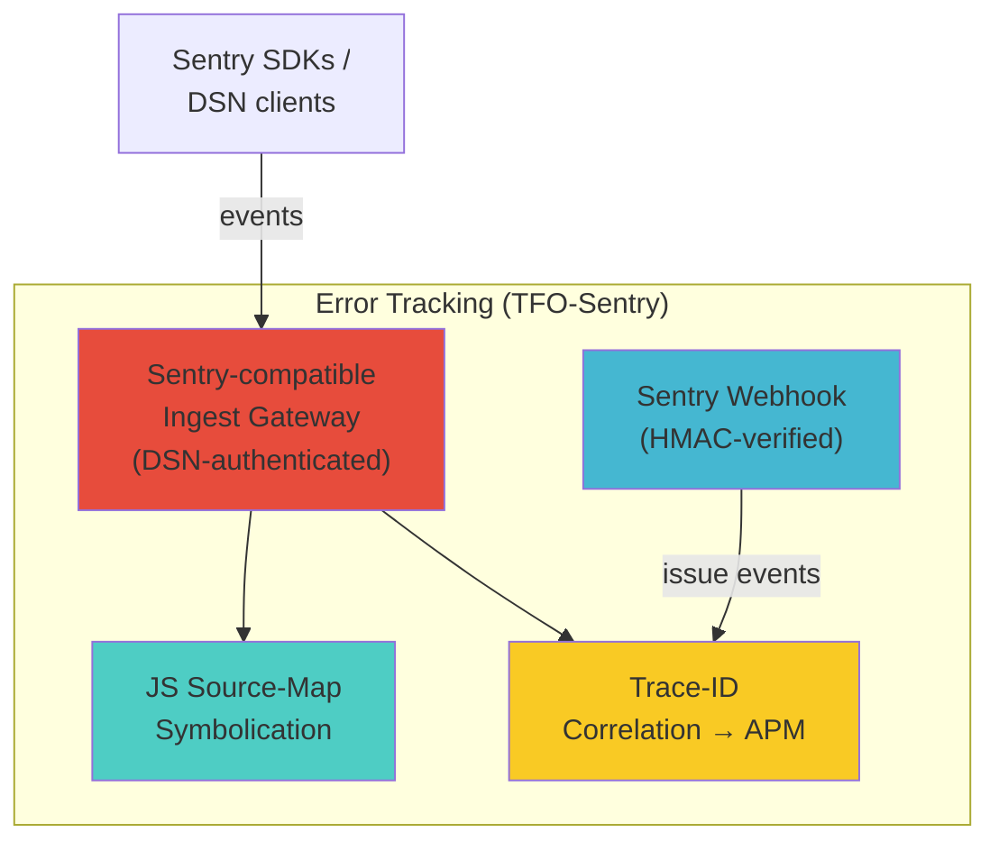

# Module: Error Tracking (TFO-Sentry)

- **Version:** 2.6.0
- **Last Updated:** November 2026
- **Status:** ✅ Production Ready (ingest gateway gated off by default)
- **Navigation:** Signals → APM → Error Tracking

---

## Module Overview

TFO-Sentry is the platform's Sentry-class **Error Tracking** capability — capturing,
grouping, and triaging application errors/exceptions alongside the rest of the
observability signals (metrics, logs, traces), with trace-id correlation back into APM.

**Purpose:** Receive and process application error events, deminify stack traces for
JS/TS front-ends, and link issues to distributed traces so an error opens directly onto
the responsible request.

---

## Capabilities

| Capability | Description |
| ---------- | ----------- |
| **Sentry-compatible ingest gateway** | Accepts Sentry-DSN-authenticated error events. **Gated off by default** — enable per deployment. |
| **JS source-map symbolication** | Resolves minified front-end stack traces back to original source. |
| **Sentry webhook** | Inbound issue/alert webhook, **HMAC-verified**, for integration with external Sentry-style alerting. |
| **Trace-id correlation** | Correlates error events to APM traces for click-through root-cause analysis. |

## Related — Deployment Tracking (roadmap)

**Deployment Tracking (TFO-Deployment)** is in planning/groundwork: correlating
deployments (e.g. `tfo-agent deploy` reports) with error-rate and performance changes.
Not yet GA.

---

## Related Modules

- [400-telemetry.md](400-telemetry.md) — metrics/logs/traces ingestion
- [600-alerts.md](600-alerts.md) — alert evaluation and routing
- [1100-agents.md](1100-agents.md) — TFO-Agent (incl. `tfo-agent deploy` deployment reporting)
